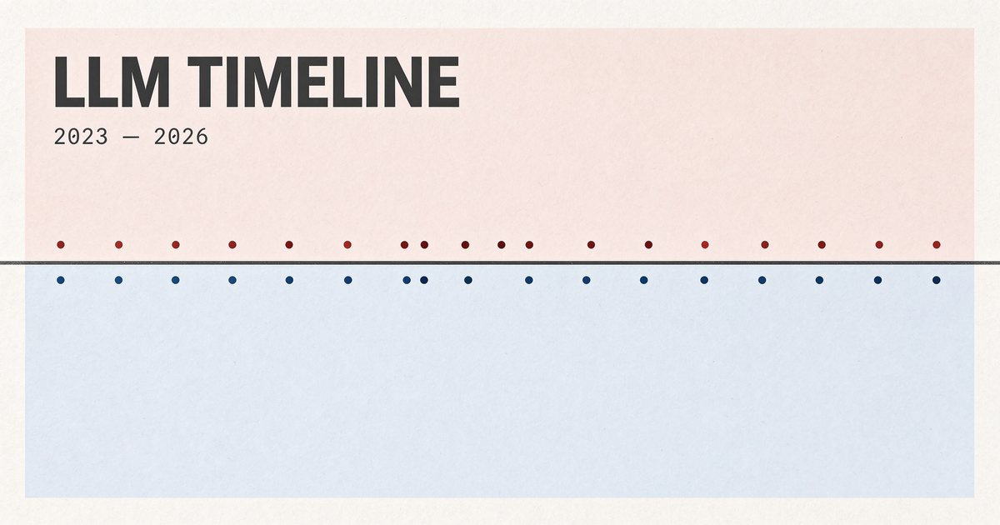

# LLM Timeline · 大模型时间线

A horizontal timeline of large-language-model releases, 2023.01 → 2026.11. Open-weight models sit above the axis on a warm wash, closed-source models below on a cool one: 183 curated releases, drawn against a monthly scale, scrolled sideways.

**[Open the live timeline →](https://llm-timeline-amber.vercel.app/)** · [简体中文 README](README.zh-CN.md)



## Features

- **Horizontal timeline** — the mouse wheel pans sideways; drag, `←` / `→`, and 92–260 px/month zoom are also supported.
- **Two camps, one axis** — open weights above the centred axis on a pale red band, closed source below on a pale blue band. 79 open, 104 closed.
- **Month ticks and release dates** — every release day gets a tick and a date label; multiple releases on the same day are stacked and counted (`09.22 · 3`).
- **Greedy lane packing** — cards that would collide fall into deeper lanes; when density gets extreme the cards switch to a single-line compact mode. Verified at 0 overlaps across three viewports and both themes.
- **Chinese / English** — one click in the header switches every label, organisation name, and Chinese model name (文心一言 → ERNIE Bot, 混元 Hy4 → Hunyuan Hy4). The choice is persisted.
- **Shader conflict field** — a hand-written WebGL fragment shader (domain-warped fBm, no three.js) runs a 420px band along the axis: red licks upward like flame, blue drifts like liquid, and the two eat into each other where they meet. Falls back to flat washes when WebGL is unavailable, and renders a single static frame under `prefers-reduced-motion`.
- **Light / dark** — moon / sun toggle; first paint follows the OS preference with no flash.
- **Hover inspector** — date, vendor, category tag, and a one-line note in the lower-left corner.
- **Overview strip** — click to jump, plus year buttons and a "Latest" shortcut.

## Stack

React 19 · TypeScript · Vite · Tailwind CSS v4 · shadcn/ui (Base UI primitives) · lucide-react

## Run

```bash
npm install
npm run dev      # local dev server
npm run build    # dist/index.html, JS & CSS inlined
npm run preview  # preview the build
```

## Deploy

The repository is linked to Vercel. Importing it elsewhere: framework **Vite**, build command `npm run build`, output directory `dist`.

## Automation

Two GitHub Actions keep the data honest without a human in the loop:

- **`collect.yml`** — every Monday 09:30 Asia/Shanghai: pulls OpenRouter + Hugging Face, applies the strict rules in `scripts/apply-candidates.mjs`, builds, opens a PR and auto-merges it once the `build` check is green. Anything ambiguous (quantised / ONNX / re-listed old models / open-weight models surfaced through OpenRouter) is held back into `data/review.json` and posted to a pinned `collect-review` issue instead of being merged.
- **Vercel Git integration** — production redeploys on every push to `master`.

## Data

`src/data/models.ts` holds 183 entries — 79 open-weight, 104 closed-source — each shaped as:

```ts
{ date: '2025-04-05', name: 'Llama 4 Maverick', org: 'Meta', openness: 'open', tag: '旗舰', note?: string }
```

`openness` is decided **per record, not per vendor**: Qwen3 ships weights while Qwen3-Max does not; GLM-4.5 is open, GLM-5 is closed. "Open" here means *open weights* — weights are publicly downloadable, not OSI-style open source with training data and code. Some are Apache-2.0, some (Llama, Gemma) carry community or use restrictions.

Dated checkpoints inside a family (`DeepSeek-V4.1-Flash-1017`, `DeepSeek-V3-0324`) get their own entry; only size, quantised and GGUF variants are collapsed.

Dates are public launch dates of a **curated sample**, not an exhaustive list. The Claude line (2 → 5.5), the Gemini line (1.0 → 4 Hydrogen) and every Llama 3 / 4 variant follow the vendors' own timelines.

Editing data is the whole contribution: append a record and the layout reflows by itself.

## Structure

```
src/
├── data/models.ts        # release records, each tagged open / closed
├── lib/timeline.ts       # month math, pixel mapping, greedy lane packing
├── lib/i18n.ts           # zh/en dictionary, org & model name localisation
├── components/ui/        # shadcn/ui components (Base UI)
└── App.tsx               # canvas, scale band, cards, header, footer
```

## Contributing

Read [CONTRIBUTING.md](CONTRIBUTING.md) and [CLA.md](CLA.md). Commits must carry a `Signed-off-by` line (`git commit -s`).

## License

[MIT](LICENSE) © 2026 catnuko
