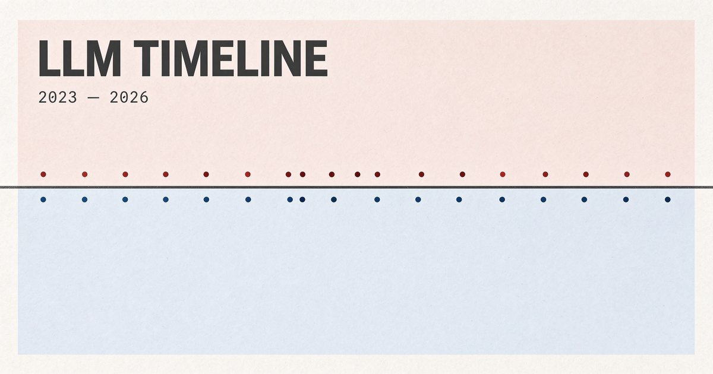

# 大模型时间线 · LLM Timeline

一条横向的大模型发布时间线，覆盖 2023.01 → 2026.11。上半区是开放权重的淡红色带，下半区是闭源的淡蓝色带，147 条发布记录沿着月份刻度排开，滚轮即横向滚动。

**[打开线上页面 →](https://llm-timeline-amber.vercel.app/)** · [English README](README.md)



## 功能

- **横向时间线**：滚轮左右平移，另支持拖拽、`←` `→` 翻页、92–260 px/月缩放。
- **两侧对抗**：轴线垂直居中，上方开放权重（淡红，52 条），下方闭源（淡蓝，95 条）。开源/闭源是全球通用的坐标，比「国内 vs 海外」更能说明行业格局。
- **月份刻度与发布日**：每个发布日打点并标注日期，同日多款模型合并计数（如 `09.22 · 3`）。
- **贪心分层**：横向会重叠的卡片自动下沉到下一层；密度过高时切换为单行紧凑卡片。三种视口、明暗两套主题下实测零重叠。
- **中英双语**：右上角一键切换，界面文案、厂商名与中文模型名（文心一言 → ERNIE Bot、混元 Hy4 → Hunyuan Hy4）随之本地化，选择持久化。
- **明暗主题**：月亮 / 太阳按钮切换，首屏按系统偏好预判，无闪白。
- **悬停详情**：左下角显示日期、厂商、标签与一句话备注。
- **缩略导航**：底部概览条点击定位，年份按钮与「最新」快速跳转。

## 技术栈

React 19 · TypeScript · Vite · Tailwind CSS v4 · shadcn/ui（Base UI 原语）· lucide-react

## 运行

```bash
npm install
npm run dev      # 本地开发
npm run build    # 产物 dist/index.html，JS 与 CSS 已内联
npm run preview  # 预览构建产物
```

## 部署

仓库已关联 Vercel。在其他平台导入时：框架选 **Vite**，构建命令 `npm run build`，输出目录 `dist`。

## 数据

`src/data/models.ts` 共 147 条（开放权重 52 / 闭源 95），单条结构为：

```ts
{ date: '2025-04-05', name: 'Llama 4 Maverick', org: 'Meta', openness: 'open', tag: '旗舰', note?: string }
```

`openness` **按每条记录判定，不按厂商判定**：Qwen3 放权重、Qwen3-Max 不放；GLM-4.5 开源、GLM-5 闭源。这里的「开源」指**开放权重**——权重可公开下载，不等于 OSI 意义上的开源（训练数据与代码未必开放）。同样开放权重，许可也不一样：Apache-2.0、Llama 社区许可、Gemma 使用限制都有。

日期取公开发布或上线日期，是人工整理的**代表性样本**，并非全量清单。Claude 全系（2 → 5.5）、Gemini 全系（1.0 → 4 Hydrogen）、Llama 3 / 4 各版本均按厂商官方时间线收录。

改数据就是全部贡献：追加一条记录，布局会自动重排。

## 代码结构

```
src/
├── data/models.ts        # 发布数据，每条带 open / closed 判定
├── lib/timeline.ts       # 月份换算、像素坐标、贪心分层布局
├── lib/i18n.ts           # 中英字典、厂商与模型名本地化
├── components/ui/        # shadcn/ui 组件（Base UI 版）
└── App.tsx               # 画布、刻度带、卡片、顶栏与底栏
```

## 参与贡献

先读 [CONTRIBUTING.md](CONTRIBUTING.md) 与 [CLA.md](CLA.md)。提交必须带 `Signed-off-by` 签署行（`git commit -s`）。

## 许可

[MIT](LICENSE) © 2026 catnuko
